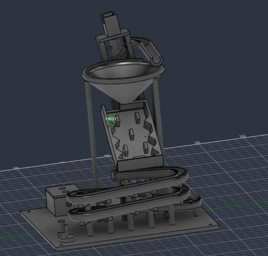
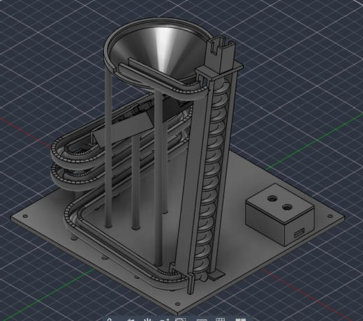
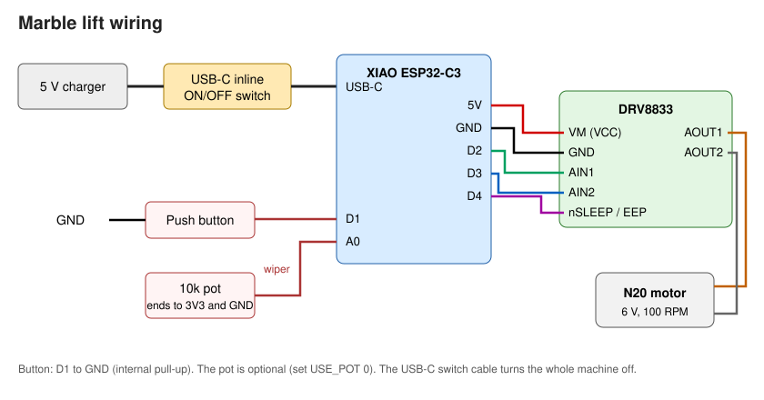

# Spiral Marble Run

A 3D-printed marble machine that runs forever. A motorised Archimedes screw lifts each marble 170 mm. A chute drops it onto the edge of a funnel, where it spins round and round before falling through. It then bounces down a Plinko board and races through about 770 mm of switchback track back to the bottom of the screw.




## How the marble moves

```
 Screw top ──chute 5°──▶ lands on the funnel EDGE (tangential, so it spins)
                              │
                              ▼ 10 mm exit
                         Plinko board (40° incline, pegs + sawtooth walls, 2 exits)
                              │
                              ▼ backstop drops it into the track
              Open U-track, 4° slope, ~770 mm, 4 hairpin switchbacks, stacked 2 levels
                              │
                              ▼
 Screw bottom ◀──────────────┘   N20 motor (or the hand crank) turns the screw
```

| Stage | What makes it work |
|---|---|
| **Screw lift** | Open screw (20 mm, 12 mm pitch, 10 mm core) next to a vertical guide rail. The marble sits half inside the screw and half in the rail, so the rail stops it spinning round with the screw and the flight pushes it straight up. The whole tower leans 8°, so the marble stays pressed against the rail. At the top it rolls out over the rail's back wall onto the chute. |
| **Funnel** | The chute runs tangent to the bowl and drops the marble onto the cone 37 mm from the centre. Its sideways speed makes it spiral down. 100° cone, 30 mm drop, 3 mm wall, 10 mm exit, 5 mm fillets, plus a 4 mm lip so it can't fly out. |
| **Plinko** | A tray tilted at 40°. Bar pegs in staggered rows every 20 mm, sawtooth deflectors on both walls, a 17 mm entry slot, two 11 mm exits and 1 mm chamfered inside corners. A hood and backstop stop a fast marble overshooting the track. |
| **Track** | Open U-channel (9 mm inside, 14 mm outside, walls 3 mm above the centre line) at 4°. It snakes back and forth on two levels with 15 mm-radius hairpins and is held up by 5 columns with 19 support arms. |
| **Base** | 180 × 180 × 4 mm with 4 M3 holes. The support posts are shaped to fit the part they hold. |

### Checked in CAD (`cad/build_log.txt`)

The Fusion script checks its own output every time it runs:

- **No part overlaps any other part.**
- **A marble-sized test ball passes along the whole track and chute** without hitting anything.
- **The stacked track levels are 18 mm apart.** The channel is only 10 mm tall, so the levels don't touch.
- **The screw makes 14 marble pockets**, one every 12 mm, and the marble rides against the rail without cutting into it from bottom to top. I checked this separately on the exported STLs.

## Repo layout

```
cad/
  MarbleRun/MarbleRun.py      Fusion script that builds the whole machine, checks it, and exports it
  MarbleRun/MarbleRun.manifest
  exports/marble_run.f3d      Fusion archive
  exports/marble_run.step     STEP for any CAD program
  exports/stl/*.stl           One print-ready STL per part
  build_log.txt               Alignment heights + check results from the last build
firmware/marble_lift/         Motor controller code (Arduino, XIAO ESP32-C3)
docs/                         Renders + wiring diagram
BOM.csv                       Parts list with prices
JOURNAL.md                    Build journal (Hack Club)
```

## Printed parts

| Part | Qty | Orientation / supports |
|---|---|---|
| Base | 1 | Flat. Tree supports under the column arms |
| Track | 1 | As modelled, tree supports underneath. Sand the inside lightly |
| ScrewTower (rail, chute, motor mount) | 1 | Rail side down, supports under the chute |
| Screw | 1 | Standing upright, tree supports under the flights |
| Funnel | 1 | Rim down, no supports |
| Plinko | 1 | Floor down (rotate flat), no supports |
| HandCrank (optional, separate file) | 1 | Disc flat on the bed, peg pointing up |
| ControlBox + ControlBoxLid | 1 each | Flat, no supports |

PLA, 0.16 mm layers, 3 walls, 15 % infill, about 250 g in total.

## Electronics



| From | To |
|---|---|
| USB charger | **USB-C inline ON/OFF switch cable**, then the XIAO's USB-C port |
| XIAO 5V / GND | DRV8833 VM / GND |
| XIAO D2 / D3 | DRV8833 AIN1 / AIN2 |
| XIAO D4 | DRV8833 nSLEEP (EEP) |
| DRV8833 AOUT1 / AOUT2 | N20 motor |
| XIAO D1 | Push button to GND |
| XIAO A0 | 10k pot wiper (pot ends to 3V3 / GND) |

The XIAO, the driver and the button live in the ControlBox. Run the motor wires up the tower column.

**Turning it off:** press the button on the USB-C inline switch cable. That cuts power to everything. The full parts list with prices is in [`BOM.csv`](BOM.csv).

## Firmware

1. Arduino IDE → Boards Manager → install **esp32 by Espressif**.
2. Open `firmware/marble_lift/marble_lift.ino`, select **XIAO_ESP32C3**, and upload.

| Control | Action |
|---|---|
| Short press | Start / stop, with a soft ramp |
| Long press (0.8 s) | Un-jam: briefly reverses the screw, then carries on |
| Pot | Speed (30–100 %) |
| Serial 115200 | `r` run, `s` stop, `u` un-jam, `+`/`-` speed, `?` status |

It stops by itself after 15 minutes (`AUTO_OFF_MIN` in `config.h`). If marbles go down instead of up, set `MOTOR_REVERSED 1`.

**No motor?** `HandCrank.stl` is a separate, optional print (it isn't part of the assembled model). Take the N20 out of its clamp and push the HandCrank's D-peg through the bracket into the top of the screw. Wind it clockwise when looking from above.

## Assembly

1. Screw the Base to a board or stick on rubber feet (M3 × 4).
2. Drop the Screw onto the pivot pin on the base, then lower the ScrewTower over it. The rail goes on the track side and the screw's top hub sits under the bracket.
3. Press the N20 into the clamp so its shaft goes into the screw's D-bore, and fix it with 2 × M1.6 screws.
4. Seat the Track on the column arms and posts, starting from the screw end.
5. Put the Plinko on its two posts, with its hood over the first track run.
6. Put the Funnel on its three posts, with the notch in its lip under the chute.
7. Wire the ControlBox, close the lid, add marbles (8 mm steel balls) and press start.

## Rebuilding / changing the model

1. Copy `cad/MarbleRun` into `%APPDATA%\Autodesk\Autodesk Fusion 360\API\Scripts` (Windows) or `~/Library/Application Support/Autodesk/Autodesk Fusion 360/API/Scripts` (Mac).
2. In Fusion: **Utilities → Add-Ins → Scripts and Add-Ins**, find **MarbleRun** → **Run**. It takes about a minute.
3. A new design opens. `log.txt` and `exports/` are written next to the script.

Every dimension is a parameter at the top of the script (`TRACK`, `FUNNEL`, `PLINKO`, `SCREW`, `RAIL`…). Heights, the track length and the hairpin spacing are worked out again automatically so the loop stays lined up. Check the log afterwards for any `OVERLAP` or `BLOCKED` lines.

## Design notes

- **Screw core is 10 mm, not 4 mm.** With a thin shaft the marble can slide in toward the centre, away from the rail, and then spin round with the screw instead of rising.
- **Screw is 170 mm tall** so that one lift covers the Plinko, the funnel and the whole track drop.
- **Track slope is 4°.** That's enough for 8 mm steel balls and makes room for a long switchback run. Glass marbles may need 5°: change `TRACK['slope']` and re-run.

## License

MIT, see [LICENSE](LICENSE).
